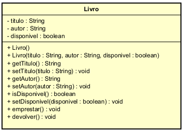

# Biblioteca Web — Spring Boot

Programação para Internet • 2º bimestre 

Evolução da Biblioteca: formulário + POST + armazenamento temporário.

## Descrição

Aplicação web simples para consultar, emprestar, devolver e cadastrar livros de uma biblioteca. O backend em Spring Boot expõe uma API REST com rotas GET e POST que trocam dados em JSON. O frontend em HTML, CSS e JavaScript consome essa API com fetch() e atualiza a tela sem recarregar a página. Os dados ficam apenas em memória, sem banco de dados e sem autenticação.

## Tecnologias

- Java 21
- Spring Boot 4.1.1 com Maven Wrapper (mvnw)
- HTML, CSS e JavaScript (fetch() para consumir a API)
- Git e GitHub

## Problema e requisitos 

**Problema:** em bibliotecas pequenas, o controle dos livros costuma ser feito em cadernos ou planilhas soltas. Isso dificulta saber quais livros existem no acervo e quais estão emprestados, e é comum emprestar um livro que já está com outra pessoa ou perder o registro de uma devolução. 

**Público-alvo:** funcionários e responsáveis por bibliotecas escolares ou comunitárias, que precisam de uma ferramenta simples para registrar o acervo e controlar a disponibilidade dos livros. 

**Escopo para 19/11:** na apresentação, a equipe entrega uma aplicação web em Spring Boot que permite cadastrar livros por um formulário, listar os livros cadastrados e emprestar/devolver um livro. Os dados ficam armazenados apenas em memória. Ficam fora do escopo: banco de dados, login de usuários e registro de quem pegou cada livro. 

**Requisitos funcionais:** 
- RF01: o sistema deve permitir cadastrar um livro com título e autor. 
- RF02: o sistema deve permitir consultar a lista de livros cadastrados. 
- RF03: o sistema deve permitir emprestar e devolver um livro.


## Arquivos

- `Livro.java` → atributos e representação do livro.
- `LivroController.java` → recebe GET e POST; devolve respostas HTTP.
- `LivroService.java` → mantém `List<Livro>` e realiza cadastro/listagem.
- `index.html` e `style.css` → interface Web.

## Fluxo do cadastro (POST)

```
FORMULÁRIO HTML (título, autor, disponível)
  ↓
JavaScript fetch()
  ↓
POST /livros + JSON
  ↓
LivroController
  ↓
LivroService
  ↓
List<Livro>
```

## Endpoints

- `GET /livro` → livro de exemplo (Emprestar e Devolver preservados).
- `GET /livros` → consultar a lista de livros.
- `POST /livros` → enviar dados de um novo livro (`Content-Type: application/json`).

Os dados ficam apenas em memória (sem banco de dados e sem autenticação).

## Como executar

```
cd biblioteca
./mvnw spring-boot:run
```

Acessar `http://localhost:8080`.

## Checklist de testes

1. Aplicação inicia sem erros? **Sim.** Iniciada com `./mvnw spring-boot:run` e acessada na porta 8080.
2. GET /livro continua funcionando? **Sim.** Retorna o JSON do livro O Hobbit.
3. Formulário envia título e autor? **Sim.** Ao cadastrar “Dom Casmurro”, apareceu “Livro cadastrado com sucesso!”.
4. POST /livros retorna resposta adequada? Sim. O livro foi cadastrado e aparece na lista. O código definido no controller é 201 (Created), por @ResponseStatus.
5. GET /livros mostra os livros cadastrados? **Sim.** Retorna `[{"titulo":"Dom Casmurro","autor":"Machado de Assis","disponivel":true}]`.
6. O que acontece ao reiniciar a aplicação? **Sim.** Após reiniciar com `./mvnw spring-boot:run`, GET /livros retornou `[]`, pois os dados ficam só em memória.

## Resultado dos testes

- GET /livro: retorna o JSON do livro (testado no navegador).
- GET /livro/emprestar e /livro/devolver: alteram a disponibilidade (testado).
- POST /livros pelo formulário: cadastra e mostra a mensagem de sucesso (testado).
- GET /livros: lista os livros cadastrados (testado).
- Reinício da aplicação: a lista volta vazia, pois os dados ficam só em memória (testado).

Limitações observadas:
- Empréstimo e devolução funcionam apenas para o livro O Hobbit, que é fixo no controller. O livro cadastrado (Dom Casmurro) não pode ser emprestado.
- Não há verificação de empréstimo duplicado (não testado).



## Justificativa da modelagem

A classe Livro tem os atributos titulo e autor porque são as informações básicas para identificar um livro, e disponivel para indicar se ele pode ser emprestado no momento. Os atributos são privados e acessados por getters e setters, o que protege os dados dentro da classe. O atributo disponivel é booleano porque o livro só pode estar em dois estados, disponível ou emprestado, e os métodos emprestar() e devolver() apenas alternam esse valor.

O LivroService guarda os livros em uma List<Livro> para separar as responsabilidades: o controller cuida das requisições e o service cuida dos dados. A lista fica em memória por ser a solução mais simples nesta etapa, e por isso os livros cadastrados são perdidos quando a aplicação reinicia.

## Divisão de Responsabilidades e Atividades

### Isabella Luiza Fernandes Borges — Frontend e Documentação

- Desenvolvimento do frontend utilizando HTML, CSS e JavaScript (`index.html` e `style.css`).
- Integração do frontend com a API do backend utilizando `fetch()`.
- Elaboração e organização do `README.md`, incluindo título, descrição, tecnologias e integrantes.
- Preenchimento do checklist de testes.
- Realização de testes dos endpoints GET e POST, com registro de evidências.
- Organização do repositório no GitHub.
- Preparação dos PDFs de entrega.

### Gean Carlos de Almeida Reis — Backend e Modelagem

- Desenvolvimento da documentação do problema, público-alvo e escopo do projeto, com entrega prevista para 19/11.
- Definição dos três requisitos funcionais (RF01 a RF03).
- Elaboração do diagrama UML da classe `Livro`, localizado em `docs/uml-classes.png`.
- Elaboração da justificativa da modelagem no `README.md`.
- Conferência e execução do backend utilizando `./mvnw spring-boot:run`.
- Registro das alterações por meio de commit no GitHub.

## Integrantes

- Gean Carlos de Almeida Reis
- Isabella Luiza Fernandes Borges

## Uso de ferramentas de IA

Durante o desenvolvimento, foi utilizado o Claude (Anthropic) como ferramenta de apoio, nas seguintes atividades:

- organização da estrutura do repositório e revisão do código;
- revisão de texto e organização dos documentos de entrega;
- montagem dos PDFs de entrega a partir das capturas de tela, dos resultados dos testes e dos textos da dupla.

A implementação do frontend (HTML, CSS e JavaScript), a execução dos testes e a coleta das evidências foram realizadas pelos integrantes da equipe. As alterações podem ser verificadas no histórico de commits deste repositório.

Os PDFs de entrega e as evidências estão na pasta: https://drive.google.com/drive/folders/1iB4vEWCLvkDRqMeeao1nq9oQNcZCUn06?usp=drive_link
